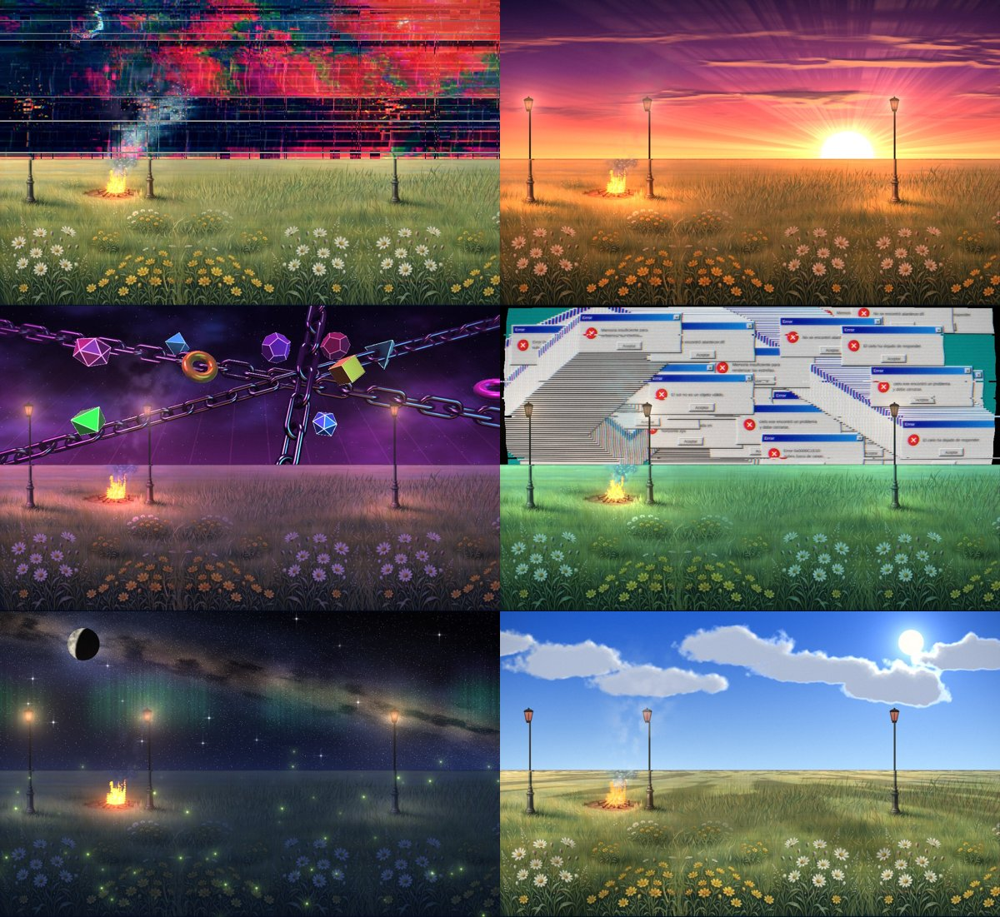
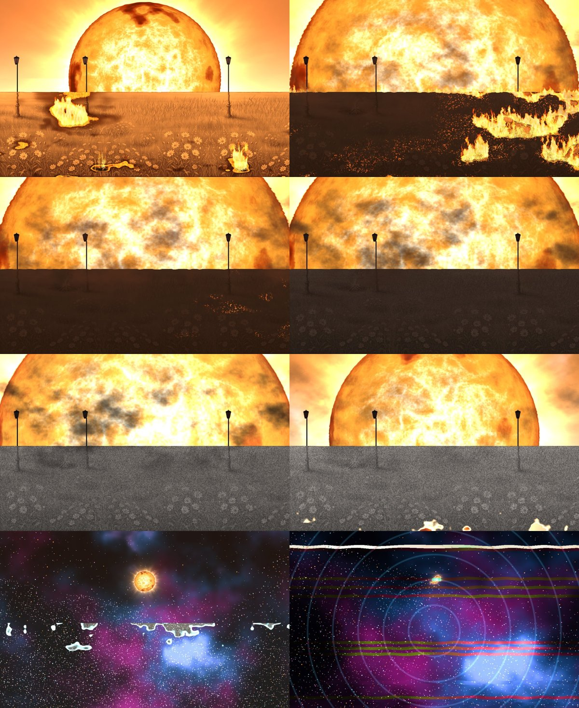

# Cielo en error

Una pradera con una fogata y tres faroles bajo un cielo que no funciona bien. Cada glitch cambia el cielo por otro distinto, hasta que un sol gigante quema el pasto, lo deja en cenizas y el polvo sale al universo en una resonancia que reinicia el mundo.

Todo se dibuja en tiempo real con shaders WebGL escritos a mano, y la música dreamcore también se genera en vivo con Web Audio. No usa librerías ni dependencias externas.



## Los cielos

| # | Escena | Qué pasa |
|---|--------|----------|
| 0 | Original | El cielo corrupto de la imagen se mueve: franjas desplazadas, separación de color, bloques y chorreos de píxeles. |
| 1 | Atardecer | Nubes con volumen iluminadas por el sol y rayos de luz que se cortan con las nubes. |
| 2 | Geometría | Sólidos 3D metálicos con aristas de neón y cadenas gigantes entrelazadas (raymarching). |
| 3 | Error del sistema | Ventanas de error retro en un monitor CRT con pantalla curva y líneas de escaneo. |
| 4 | Noche | Vía láctea, luna creciente con relieve, aurora, estrellas fugaces y luciérnagas. |
| 5 | Día | Cúmulos con sombra propia; sus sombras avanzan sobre el campo. |
| 6 | Sol gigante | Plasma solar con corona, el pasto se seca y arde, queda en cenizas, el polvo se va al universo y todo resuena. |



En todas las escenas la fogata tiene llamas vivas y humo, el pasto se mece con el viento y los faroles iluminan el suelo.

## Música

El botón **♪ música** activa una pieza dreamcore generativa (72 BPM, pads con reverberación, caja musical y cinta que ondula) que cambia con cada cielo.

## Controles

- **Clic** en la imagen o **flecha derecha**: siguiente cielo
- **Espacio** o botón **pausa**: pausar y seguir
- **♪ música**: activar o silenciar el sonido (también se activa con el primer toque o tecla)

## Ver en línea con GitHub Pages

1. Sube el contenido de esta carpeta a un repositorio.
2. En el repositorio entra a **Settings → Pages**.
3. En **Source** elige **Deploy from a branch**, la rama `main` y la carpeta `/ (root)`.
4. Guarda. En uno o dos minutos la página queda en `https://TU-USUARIO.github.io/NOMBRE-DEL-REPO/`.

## Verlo en tu computadora

Si abres `index.html` con doble clic, el navegador bloquea la lectura de la imagen desde el disco y no arranca el WebGL. Sírvelo con un servidor local:

```bash
python3 -m http.server 8000
```

y abre `http://localhost:8000`.

## Archivos

```
index.html                         toda la animación, los shaders y la música
scene.jpg                          la imagen base (pradera y cielo original)
escenas.jpg, sol.jpg               capturas para este README
```

## Requisitos

Un navegador actual con WebGL (Chrome, Edge, Firefox o Safari). Si la computadora va lenta, la resolución del shader baja sola para mantener la fluidez. Sin WebGL, se muestra una versión simplificada en 2D.
